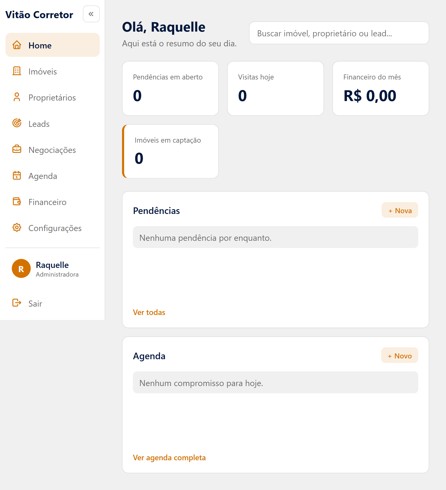
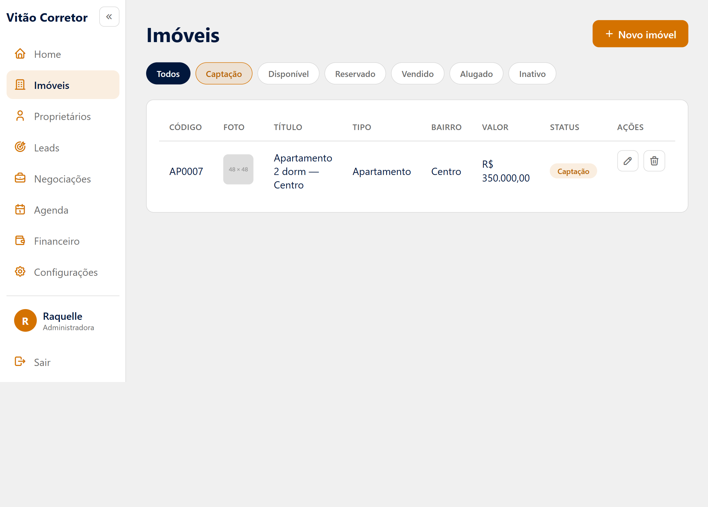
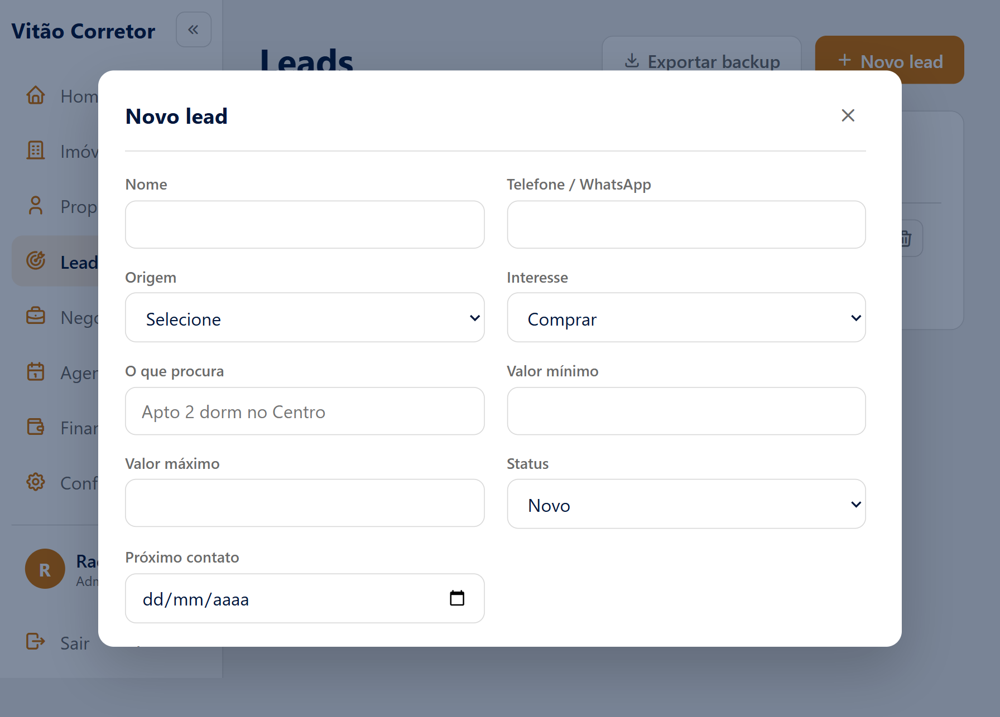
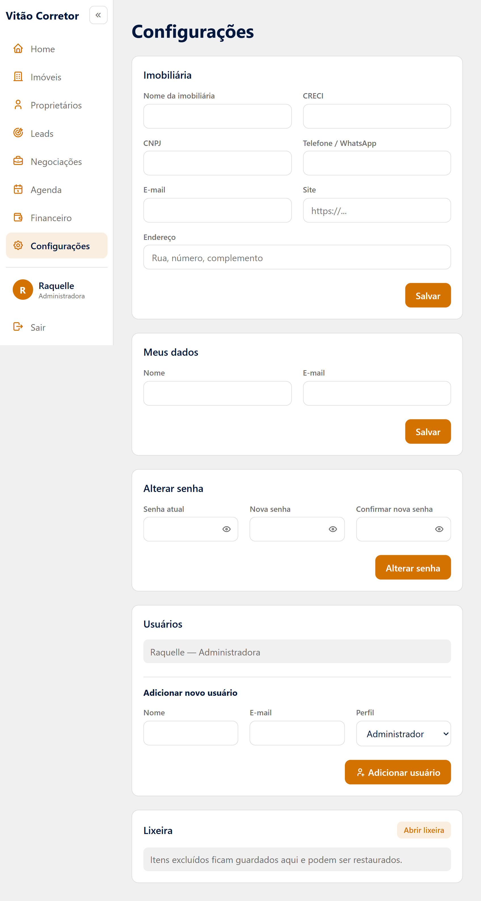

# admin-imob

Painel administrativo para a imobiliária onde trabalho, feito do zero em
HTML, CSS e JavaScript puro.

Hoje o controle é feito em planilhas e anotações soltas: imóveis numa aba,
clientes em outra, compromissos no papel. Este sistema junta tudo num lugar
só — e está sendo construído para uso real, não como exercício.

## Status

Em desenvolvimento. As sete telas estão prontas em HTML e CSS. O JavaScript
está sendo implementado um módulo por vez, começando por Leads.

## O que tem no sistema

| Módulo | Para que serve |
|---|---|
| **Home** | O resumo do dia: pendências, visitas, financeiro do mês e imóveis em captação |
| **Imóveis** | Cadastro com o código que já usamos, filtro por status e destaque para captação |
| **Proprietários** | Quem são os donos dos imóveis e como falar com eles |
| **Leads** | O funil de interessados, da primeira conversa ao fechamento |
| **Negociações** | Vendas e locações em andamento, com o cálculo da comissão |
| **Agenda** | Visitas, captações, assinaturas e entregas de chave, por responsável |
| **Financeiro** | Entradas e saídas, com o resumo do mês |
| **Configurações** | Dados da imobiliária, usuários e lixeira |

## As telas

## Por que fiz assim

**Sem framework, de propósito.** Quero dominar HTML, CSS e JavaScript antes
de partir para React e Node com MySQL, que é onde este projeto vai chegar.
Pular essa etapa seria construir em cima de algo que eu não entendo.

**Nada é apagado de verdade.** Tudo que é excluído vai para uma lixeira e
pode voltar. Como o sistema vai ser usado por pessoas com níveis diferentes
de familiaridade com tecnologia, um clique errado não pode custar um
cadastro.

**Três níveis de acesso.** Administrador e corretor veem tudo. O corretor
que trabalha na rua vê só os imóveis disponíveis, em modo leitura — é o que
ele precisa para atender um cliente na porta de um imóvel.

**Os dados ficam no navegador, por enquanto.** Enquanto não existe
back-end, tudo vai para o `localStorage`, com exportação de backup. A
modelagem já foi pensada para a migração ao banco relacional.

**Um arquivo de CSS só.** Organizado em seções, com as cores em variáveis e
as classes reaproveitadas entre as telas. As convenções que sigo estão no
[CLAUDE.md](CLAUDE.md).

## Estrutura

admin-imob/
├── index.html # login
├── css/app.css # estilos de todo o sistema
├── js/app.js # comportamento
└── pages/ # telas internas

## Rodando o projeto

Não tem build nem dependência. É só abrir o `index.html` no navegador, ou
servir a pasta com qualquer servidor estático — eu uso a extensão Live
Server do VS Code.

## O que vem depois

- [ ] JavaScript dos módulos, começando por Leads
- [ ] Back-end em Node.js com MySQL
- [ ] Site público para divulgar os imóveis
- [ ] Administração de locação: contratos, reajuste, inadimplência

---

Feito por [Raquelle Oliveira](https://github.com/raquelleoliveira).

